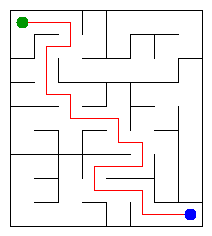

# Assignment 3. Maze Escape

Student ID: **250245**  
Name: **Diyar Daniyarov**  
Group: **SE-2510**  
Maze size (rows x columns): **9 x 8** (72 cells, 127 walls)

## Run

Requires Java 17 or newer. Run these commands from this project folder:

```sh
javac --release 17 -d out src/*.java
java -Djava.awt.headless=true -cp out Main
```

Open `output/maze.html` in a browser to play the maze, show the solution, animate construction, and display zones and slides. The headless setting lets the supplied renderer save the PNG from a terminal without a desktop window.

To regenerate the exact personal input:

```sh
java tools/MakeVariant.java 250245 data
```

## Program output

```text
Broken: 71
Kept: 56
Last broken wall: 108
MST cost: 22327
Heaviest broken wall: 888
Path length: 21
DFS visited: 52
Dead ends: 21
Zones: 9
Largest zone: 14
Is DAG: 0
Flow stages: 5
Fastest route cost: 17
```

Kruskal cost: **22327**. Prim cost: **22327**.



### Mission 0

`find(x)` returns the root representing the set containing x, while `union(a, b)` merges two different sets and reports whether a merge happened. Union by size attaches the smaller tree to the larger one, and path compression makes every node on a find path point directly to its root. Together they give amortized O(alpha(n)) time per operation over a sequence of operations.

### Mission 1

Every successful union connects two different components without creating a cycle. Since all cells become connected, the resulting maze is a tree with `R*C` vertices. Therefore, exactly `R*C - 1` walls are broken.

The grid initially contains `R*(C-1) + C*(R-1)` interior walls. The number of walls kept is:

`R*(C-1) + C*(R-1) - (R*C - 1) = (R-1)*(C-1)`

For my 9×8 maze, 71 walls are broken and 56 remain.

### Mission 2

Kruskal and Prim both give 22327 for the generated input. Kruskal repeatedly chooses the cheapest edge joining separate components, while Prim chooses the cheapest edge leaving its current tree; both choices are justified by the MST cut property. All wall costs are distinct, so this input also has a unique MST.

### Mission 3

The broken walls form a connected graph without cycles, which is a tree, and a tree has exactly one simple path between any two cells. Two different simple paths would create a cycle. DFS uses explicit arrays as its stack and stores the next direction in each frame, so it preserves the required up-right-down-left order without relying on Java's call stack.

### Mission 4

The first pass records finish order on the original graph, and the second pass visits vertices in decreasing finish order on the reversed graph. Reversal preserves mutual reachability within each SCC while preventing the next unassigned component from escaping into another unassigned component in this order. Since the input forbids self-loops, a directed cycle exists exactly when some SCC has more than one vertex, so the slides are a DAG exactly when Zones equals the number of cells.

### Mission 5

The SCC numbers are a topological order: every slide between different zones goes from a smaller number to a larger one. Therefore all incoming values are final before a zone is processed; one pass updates the longest chain and cheapest distance, with internal slides ignored and parallel zone edges reduced to their minimum cost. The pass costs O(z + q), where z is the number of zones and q the number of distinct edges between them; building the graph with hash maps takes expected O(n + m) time overall.

## AI use

I used ChatGPT to assist with understanding the assignment requirements, writing and debugging Java implementations, and preparing the README.

I compiled and tested the algorithms, checked their outputs against the expected results, and reviewed their implementation.

No external graph or DSU libraries were used.

## Timing (Mission 7)

Benchmarks were performed on October 23, 2026, using the supplied `Bench.java` and Eclipse Temurin OpenJDK 25.0.1 LTS. Each algorithm was executed five times for each maze size. Execution times are measured in milliseconds, and averages are rounded to whole milliseconds. The benchmark code was not modified.

| Maze | Kruskal: five runs; average | Prim: five runs; average |
|---|---|---|
| 100 × 100 | 11, 6, 5, 7, 7; **7 ms** | 15, 4, 4, 7, 7; **8 ms** |
| 300 × 300 | 53, 90, 59, 32, 31; **53 ms** | 49, 44, 49, 48, 46; **47 ms** |
| 1000 × 1000 | 561, 551, 553, 589, 555; **562 ms** | 1104, 1053, 1164, 1206, 1086; **1123 ms** |

For a rectangular grid with n cells, the number of walls is O(n). Both Kruskal and Prim have O(n log n) time complexity for these inputs.

The measurements show that execution time increases as the maze grows. Kruskal was faster for the 1000 × 1000 maze, while Prim was faster for the 300 × 300 maze. The results may vary due to JVM warm-up, garbage collection, and system load.

## Complexity

n is the number of cells and m the number of relevant walls or slides. Auxiliary space includes constructed adjacency lists, stacks and queues; alpha is the inverse Ackermann function.

| algorithm | time | space | assumptions |
|---|---|---|---|
| DSU find and union | Amortized O(alpha(n)) per operation; initialization O(n) | O(n) total DSU storage; O(1) per operation | Union by size and path compression; amortized over a sequence |
| File-order maze | O(n + m alpha(n)) | O(n) | Connected grid; no sorting |
| Kruskal | O(n + m log m + m alpha(n)) | O(n + m) | Comparison sort of wall indexes; connected grid |
| Prim | O(n + m log(m+1)) | O(n + m) | Lazy edge priority queue; connected grid; costs summed in long |
| DFS | O(n + m) | O(n + m) | m open edges; at most four neighbours per cell; iterative stack |
| Kosaraju | O(n + m) | O(n + m) | Two iterative passes with forward and reverse adjacency lists |
| Route in the zone graph | Expected O(n + m) including graph construction; O(z + q) for the DAG pass | O(z + q), at most O(n + m) | Expected constant-time hash operations; z zones, q distinct inter-zone edges; zone IDs topologically ordered |

## Validation

The supplied checker passes all 13 lines for tiny, small and dag. Additional DSU checks cover self-union, repeated unions, balanced merges, singleton and empty sets, and 100,000 sequential merges.

`tools/AlgorithmTest.java` also checks 200 random mazes against a recursive small-maze DFS reference, 50 small grids against exhaustive spanning-tree enumeration, and 300 random directed graphs against transitive closure and repeated-relaxation references. Million-cell chain and cycle tests exercise both iterative Kosaraju passes, iterative escape and zone routing without recursion.

